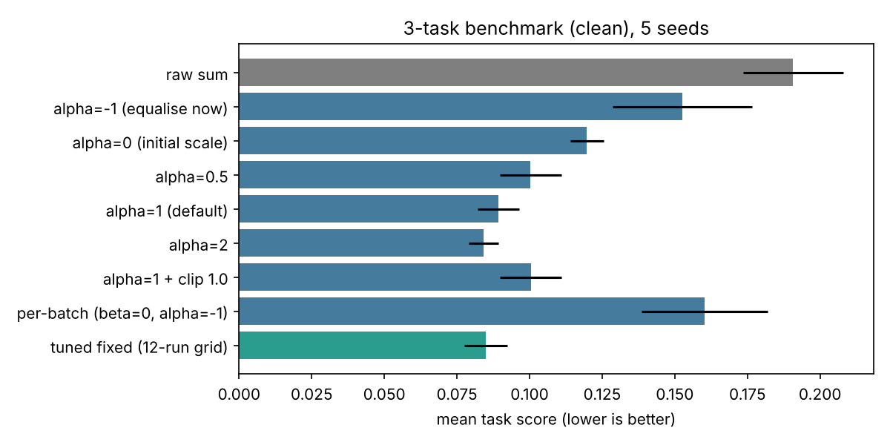
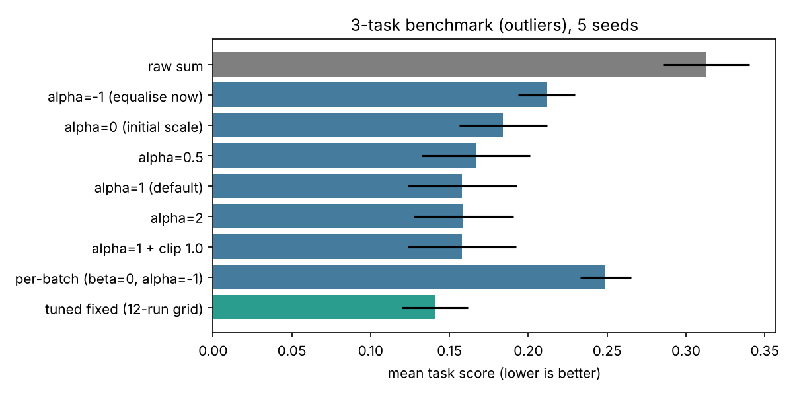

# Adaptive Loss Balancing

This repository contains the code for the study "Adaptive Loss Balancing:
statistics-driven per-loss weights as a drop-in replacement for hand-tuned
multi-loss weighting" by Jeff Rhoades (@rhoadesScholar), submitted to the FAAFO
Consortium of Rhoades.

## Conclusion (TL;DR)

**It works, with one important twist.** The original idea was to keep each
loss's contribution steady by dividing it by a running average of its own size.
That beats the raw sum of losses by a lot, but it has a hidden flaw. Losses that
shrink fast (easy tasks) end up with *more and more* weight, and the hardest
task is starved. The fix is a single exponent, `alpha`, that instead gives more
weight to losses that are *lagging* in progress. With `alpha = 1` (the default),
one untuned run matches a 12-run grid search of fixed weights on clean data
(0.089 ± 0.007 vs. 0.085 ± 0.007) and gets most of the way there with noisy
labels (0.158 vs. 0.141). Two side findings: computing the weight from the
*current* batch is worse than using past batches (it biases training), and
gradient clipping did not help here. It is optional and off by default.
**Recommendation: use it as the default for multi-loss training, and still do a
small sweep of per-loss `priorities` when a model really matters.** Caveat:
one synthetic benchmark; check it on a real model.

## Idea

Training on several losses at once means picking weights, `L = Σ w_i L_i`. The
losses usually have unrelated units and scales (pixels vs. nats vs. a KL term),
so the raw sum is dominated by whichever happens to be largest. The usual fix is
a grid search over the weights: noisy, costly, and redone for every new model.

The hope: set the weights automatically from each loss's own statistics, so that
each loss contributes a controlled amount, whatever its scale. A side hope was
that this would also smooth the size of the gradients going into Adam when
batch losses jump around. (It mostly doesn't, see below.)

## Method

For each loss `L_i`, with no gradient flowing through the weight:

```
ref_i = mean |L_i| over the first `warmup` steps        # its natural scale
ema_i = EMA of |L_i| over past steps (decay `beta`)     # where it is now
r_i   = ema_i / ref_i                                   # progress ratio (1 = none yet)
w_i   = priority_i / ref_i * clamp((r_i / mean_j r_j) ** alpha, 1/max_ratio, max_ratio)
```

`alpha` sets how the weights react to progress:

| `alpha` | Weight is ~ | Effect |
| --- | --- | --- |
| `-1` | `1 / ema_i` | Every loss contributes equally *now*. This is the original idea. Easy losses gain weight over time. |
| `0` | `1 / ref_i` | Fixed after warmup. Removes units and scale only. |
| `> 0` | `(1 / ref_i) * r_i ** alpha` | Losses that lag behind gain weight. This is the "inverse training rate" idea from GradNorm (Chen et al., 2018), applied to loss values instead of gradient norms. |

Design choices:

* **Weights come from past batches only.** A weight computed from the current
  batch is correlated with that batch's gradient. With `w = 1 / L_batch` the
  update becomes the gradient of `log L`, which biases where training settles.
  The benchmark confirms this costs accuracy (the "per-batch" rows).
* **Slow weights do not flatten per-batch spikes.** A batch with 10× the loss
  still sends ~10× the gradient. That is what gradient clipping is for, so it is
  available as an option.
* **Adam already ignores the overall loss scale**, so normalising the *total*
  does little. What matters is the balance *between* losses, which Adam cannot
  fix because the losses share parameters.
* **Negative losses** (e.g. NLL) are fine; statistics use `|L_i|`.
* **DDP-safe:** loss values are averaged across ranks before the statistics
  update, so every rank computes identical weights.

## Usage

```python
import torch
from AdaptiveLossBalancing import MultiLossOptimizer

opt = MultiLossOptimizer(
    torch.optim.Adam(model.parameters(), lr=1e-3),
    names=["recon", "kl", "adv"],
    alpha=1.0,                  # progress exponent (default 1.0)
    priorities={"adv": 0.5},    # optional: how much each loss matters (default 1.0)
    clip_grad_norm=None,        # optional gradient clipping (default off)
)

for batch in loader:
    losses = compute_losses(model, batch)   # {"recon": ..., "kl": ..., "adv": ...}
    stats = opt.step(losses)                # zero_grad, combine, backward, clip, step
    log(stats)                              # per-loss values and weights
```

If you manage `backward()` and `step()` yourself, use the balancer alone:

```python
from AdaptiveLossBalancing import LossBalancer

balancer = LossBalancer(["recon", "kl"])
total, stats = balancer({"recon": l1, "kl": l2})
total.backward()
```

### Parameters

| Parameter | Default | Meaning |
| --- | --- | --- |
| `alpha` | `1.0` | Progress exponent (see table above). |
| `beta` | `0.99` | EMA decay for each loss's current level. Higher is slower and less noisy. |
| `warmup` | `20` | Steps averaged to set each loss's reference scale. |
| `priorities` | all `1.0` | Per-loss multipliers. The one deliberate knob: how much a loss matters to you. |
| `max_ratio` | `10.0` | Caps the progress factor to `[1/max_ratio, max_ratio]`. Stops runaway weights. |
| `clip_grad_norm` | `None` | Optional gradient-norm clipping (`MultiLossOptimizer` only). |
| `balance` | `True` | `False` gives a plain sum weighted by `priorities`, for A/B baselines. |

Both classes have `state_dict()` / `load_state_dict()` for checkpointing.

**Watch out with `alpha > 0`:** a loss with a large irreducible floor (e.g.
label noise) never "makes progress", so it keeps gaining weight up to the
`max_ratio` cap. If one loss is known to be noisy, lower its `priority` or use
a smaller `alpha`.

## Findings

### Benchmark

A synthetic 3-task network (`compare.py`): a shared MLP trunk with three heads
whose losses differ in scale by ~10⁴.

* **A:** regression, target scale ~1 (easy).
* **B:** regression, target scale ~100 (the hardest task).
* **C:** 4-way classification with cross-entropy.

Each task is scored on held-out data, lower is better: MSE divided by target
variance for A and B, error rate for C. `mean` is their average. 5 seeds, 1500
Adam steps each. "Tuned fixed" runs a 12-point grid over the weights of B and C
for each seed, picks on validation, and reports test, so it costs 12× more
compute. Two settings: **clean** labels, and **outliers** (3% of B's training
labels get huge noise, which causes loss spikes and an irreducible floor).

**Clean labels**

| Method | Runs | A | B | C | Mean |
| --- | --- | --- | --- | --- | --- |
| raw sum | 1 | 0.296 | 0.102 | 0.174 | 0.191 ± 0.017 |
| `alpha = -1` (equalise now) | 1 | 0.077 | 0.362 | 0.019 | 0.153 ± 0.024 |
| `alpha = 0` (initial scale) | 1 | 0.068 | 0.269 | 0.022 | 0.120 ± 0.006 |
| `alpha = 0.5` | 1 | 0.076 | 0.198 | 0.027 | 0.100 ± 0.011 |
| **`alpha = 1` (default)** | 1 | 0.082 | 0.158 | 0.027 | **0.089 ± 0.007** |
| `alpha = 2` | 1 | 0.086 | 0.137 | 0.030 | 0.084 ± 0.005 |
| `alpha = 1` + clip 1.0 | 1 | 0.084 | 0.186 | 0.031 | 0.100 ± 0.011 |
| per-batch weights (`beta = 0`, `alpha = -1`) | 1 | 0.090 | 0.371 | 0.021 | 0.160 ± 0.022 |
| tuned fixed weights | 12 | 0.103 | 0.122 | 0.030 | 0.085 ± 0.007 |



**With label outliers on task B**

| Method | Runs | A | B | C | Mean |
| --- | --- | --- | --- | --- | --- |
| raw sum | 1 | 0.403 | 0.308 | 0.227 | 0.313 ± 0.027 |
| `alpha = -1` (equalise now) | 1 | 0.082 | 0.534 | 0.018 | 0.211 ± 0.018 |
| `alpha = 0` (initial scale) | 1 | 0.080 | 0.454 | 0.018 | 0.184 ± 0.028 |
| `alpha = 0.5` | 1 | 0.080 | 0.401 | 0.019 | 0.167 ± 0.034 |
| **`alpha = 1` (default)** | 1 | 0.083 | 0.366 | 0.025 | **0.158 ± 0.035** |
| `alpha = 2` | 1 | 0.108 | 0.324 | 0.045 | 0.159 ± 0.032 |
| `alpha = 1` + clip 1.0 | 1 | 0.083 | 0.366 | 0.025 | 0.158 ± 0.034 |
| per-batch weights (`beta = 0`, `alpha = -1`) | 1 | 0.105 | 0.619 | 0.022 | 0.249 ± 0.016 |
| tuned fixed weights | 12 | 0.089 | 0.302 | 0.031 | 0.141 ± 0.021 |



### What we learned

1. **Any balancing beats the raw sum by a lot** (−20% to −55%), because the raw
   sum lets the largest-scale loss dominate.
2. **The original idea (`alpha = -1`) is the weakest balancer.** Look at task B:
   dividing by the *current* loss rewards fast progress, so the easy tasks (A,
   C) soak up weight and the hard task (B) is starved.
3. **Steering weight toward lagging losses fixes it.** Results improve steadily
   from `alpha = -1` to `1`, then plateau (`alpha = 2` is about the same, and
   an extra probe at `alpha = 3` was slightly worse). The default `alpha = 1`
   is at the start of the plateau.
4. **It closes most of the gap to tuned weights at 1/12 the compute.** It
   matches them within noise on clean data. With outliers it gets ~90% of the
   way from raw sum to tuned.
5. **Per-batch weights hurt** (0.160 vs. 0.153 clean, 0.249 vs. 0.211 with
   outliers, against the same `alpha = -1` with slow weights). This is the bias
   explained above.
6. **Clipping did not help.** Clipping at 1.0 was neutral with outliers and
   slightly harmful on clean data. The threshold is model-specific, so it stays
   optional and off by default.

### Related work

Uncertainty weighting (Kendall et al., 2018), GradNorm (Chen et al., 2018),
Dynamic Weight Average (Liu et al., 2019), CoV-weighting (Groenendijk et al.,
2021), loss balancing for PINNs (Wang et al., 2021; ReLoBRaLo), FAMO (Liu et
al., 2023). Kurin et al. (2022) and Xin et al. (2022) found that tuned fixed
weights usually match fancier methods. This study agrees, and the point here is
to get close to tuned weights *without* the tuning.

## Setup

To install the required packages, run the following from this folder:

```bash
micromamba env create -n ALB python==3.11 -f requirements.txt -c pytorch -y
micromamba activate ALB
pip install -e .
```

## Reproduce the results

```bash
python -m AdaptiveLossBalancing.compare                 # label outliers (~3 min on CPU)
python -m AdaptiveLossBalancing.compare --no-outliers   # clean labels
```

Each writes `results_<setting>.json` and `results_<setting>.png` into the
package folder. Options: `--seeds`, `--steps`.

## Tests

```bash
pytest AdaptiveLossBalancing/tests.py
```
