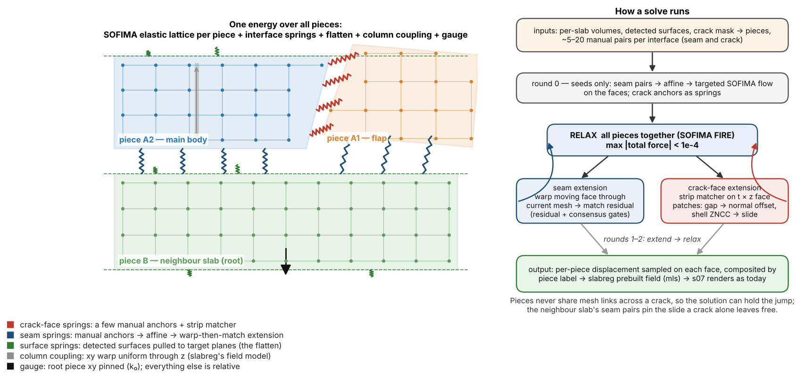
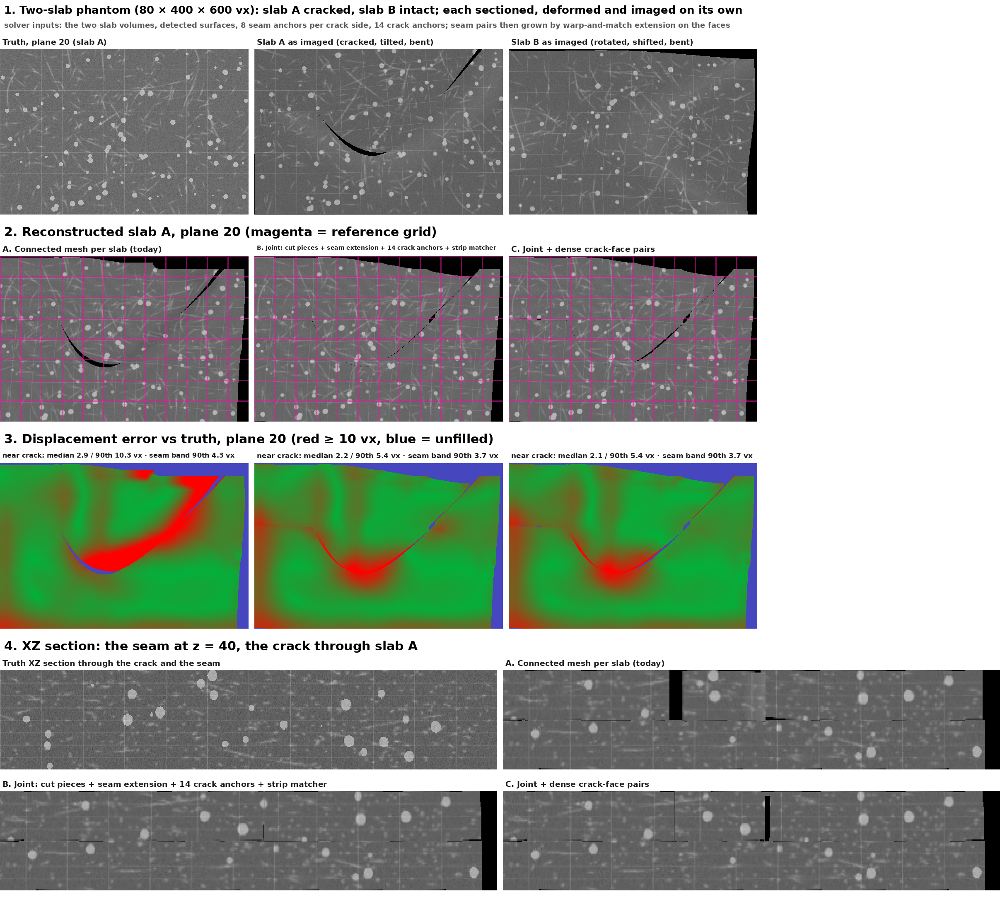

# gelmesh — joint relaxation of cracked gel slabs (POC)

Crack closing, slab-to-slab (seam) registration and per-column flattening solved as **one spring-mesh
relaxation**, on SOFIMA primitives. Proof of concept for an alternative registration route in
[slabreg](https://github.com/e11bio/slabreg); validated on a two-slab synthetic phantom with ground truth.

```
pip install -e .            # needs jax, sofima, connectomics (see pyproject)
gelmesh phantom             # ~1 min: builds phantom2.pkl (80x400x600 truth, two imaged slabs)
gelmesh run                 # ~25 min CPU: all variants -> results.pkl + results.pkl.json + a markdown table
gelmesh figure              # fig_joint.png
gelmesh bench               # relaxation cost vs mesh size -> bench.json
python -m pytest -q tests   # unit tests, no phantom needed
```



## The idea in one paragraph

A smooth, connected spring mesh cannot represent the displacement **jump** across a crack, so slabreg's
per-slab warp leaves cracks open and smears tissue around them. Cut the mesh along the crack instead: every
connected component of tissue (flap, main body, the neighbouring slab) is its own **piece**, and every
**interface** between pieces — a crack face pair or a slab seam — contributes zero-length correspondence
springs. The flatten is a third set of springs pulling surface samples to their target plane. With the
correspondences fixed, the energy is one sparse function over all pieces, so crack closing and seam
registration are solved together: the neighbour slab pins the crack's otherwise unobservable tangential
slide, and the seam is registered with the crack already closed. Correspondences come the way they do in
slabreg today — a few manual anchors per interface, grown automatically: `grid_extend`-style
warp-then-match on seam faces, and a **strip matcher** on crack faces.

```
E(x) = Σ_pieces Σ_links ½k (‖(x_i − x_j) + l_ij‖ − ‖l_ij‖)²   internal: SOFIMA elastic_mesh_3d, a rotation-invariant
                                                              Hookean lattice (length-only, NOT quadratic in x)
     + Σ_(a,b)∈correspondences ½k_pair‖(a+OFF_a+x_a) − (b+OFF_b+x_b)‖²     seam + crack faces (anchors + autos)
     + Σ_surface samples ½k_surf (x_z − Z_target)²             the flatten
     + Σ_nodes ½k_col‖x_xy − mean_z(x_xy)‖²                    column coupling (xy warp uniform through z)
     + ½k_0‖x_xy‖² on the root piece                            gauge
```

Only the internal term is non-quadratic, and it is so on purpose: a piece (the flap) must be free to rotate
rigidly at zero cost. A linear-spring lattice would be quadratic but penalises exactly that rotation. The
solve is therefore SOFIMA's FIRE integrator; a direct sparse solve is possible only after linearising each
piece about a rigid/affine estimate (see "Compute cost").

## What is in the package

| module | what |
|---|---|
| `geom.py` | phantom and mesh geometry (sizes, node stride, piece offsets) |
| `phantom.py` | two-slab phantom: slab A cracked (flap rotation/slide/tilt, open gap + closed sheared seam), slab B intact; each slab bent, imaged on its own |
| `relax.py` | the solver: batched per-piece meshes, custom `mesh_force` (pair springs, surface springs, column coupling), FIRE relaxation with a divergence guard, inversion and side-consistent rendering |
| `faces.py` | seam faces: anchors → affine → coarse-to-fine targeted SOFIMA flow (round 0); warp-then-match extension with residual + consensus gates (rounds ≥ 1) |
| `strip.py` | **crack-face strip matcher**: strips anchored on piece 1's face, across-crack offset from gap closure, along-crack offset from per-row ZNCC of thin shells on either face over a t × z patch; gates: score, peak margin, edge-of-search, along-crack consensus |
| `crack.py` | runs the strip matcher in the current global frame and maps pairs back to piece-source coordinates |
| `solve.py` | `Problem` (pieces, labels, surfaces, faces, anchors) and `solve()` (rounds of extension → relax) |
| `experiment.py` | the variants, truth-derived anchors, truth frame, error summaries |
| `figure.py`, `bench.py`, `cli.py` | figure, cost benchmark, command line |
| `scripts/schematic.py` | the schematic above |

## Variants

| variant | pieces | crack correspondences | seam |
|---|---|---|---|
| `CONNECTED` | A (one mesh), B | none | extension, unmasked — slabreg today |
| `JOINT` | A1 (flap), A2 (main), B | 14 anchors (6–8 at two z-levels) | extension, masked per piece |
| `JOINT_EXT` | same | 14 anchors + strip matcher | same |
| `JOINT_DENSE` | same | ~160 truth pairs at four z-levels (perfect matcher stand-in) | same |
| `JOINT_FEW`, `_FEW_EXT` | same | 4–5 anchors (± strip matcher) | same |
| `NONEIGHBOUR*` | A1, A2 only | as above | none — the crack-closure floor without a neighbour |

Metric: displacement error of every rendered voxel's source vs. ground truth, in the root piece's frame
(slab B's own xy, both slabs flattened in z), excluding a 24-px border. *Near crack* = within 80 px of the
crack line in slab A; *seam band* = |z − 40| < 6; *far* = the rest.



## Results

| variant | near crack med / p90 | flap med / p90 | main med / p90 | seam band med / p90 | far med / p90 | unfilled near crack | seam pairs | crack anchors | crack autos |
|---|---|---|---|---|---|---|---|---|---|
| CONNECTED | 2.75 / 10.17 | — | — | 0.87 / 4.40 | 0.46 / 2.16 | 3.9% | 412 | 0 | 0 |
| JOINT | 2.25 / 5.50 | 2.45 / 8.05 | 2.09 / 4.30 | 0.86 / 3.27 | 0.47 / 1.93 | 3.5% | 459 | 14 | 0 |
| JOINT_EXT | 2.18 / 5.33 | 2.32 / 6.00 | 2.14 / 4.92 | 0.87 / 3.34 | 0.47 / 2.04 | 3.4% | 458 | 14 | 99 |
| JOINT_DENSE | 2.02 / 5.33 | 2.29 / 6.00 | 1.95 / 4.80 | 0.86 / 3.33 | 0.47 / 2.03 | 3.6% | 450 | 144 | 0 |
| JOINT_FEW | 2.40 / 5.89 | 2.89 / 8.30 | 2.01 / 4.28 | 0.86 / 3.34 | 0.46 / 1.94 | 3.4% | 453 | 5 | 0 |
| JOINT_FEW_EXT | 2.37 / 5.69 | 2.85 / 7.14 | 2.14 / 4.74 | 0.86 / 3.47 | 0.46 / 2.03 | 3.4% | 451 | 5 | 85 |
| NONEIGHBOUR | 0.53 / 6.40 | 4.93 / 7.81 | 0.24 / 0.49 | — | 0.34 / 7.59 | 0.6% | 0 | 14 | 0 |
| NONEIGHBOUR_EXT | 0.57 / 6.63 | 4.26 / 8.66 | 0.26 / 0.53 | — | 0.34 / 9.41 | 0.5% | 0 | 14 | 89 |
| NONEIGHBOUR_DENSE | 0.54 / 5.32 | 3.06 / 7.19 | 0.27 / 0.52 | — | 0.34 / 8.67 | 0.9% | 0 | 144 | 0 |
| NONEIGHBOUR_FEW | 0.55 / 8.47 | 5.00 / 9.99 | 0.22 / 0.48 | — | 0.34 / 7.26 | 0.5% | 0 | 5 | 0 |
| NONEIGHBOUR_FEW_EXT | 0.56 / 7.16 | 5.00 / 8.84 | 0.25 / 0.52 | — | 0.34 / 9.76 | 0.4% | 0 | 5 | 89 |

(`gelmesh run`, seed 5, 3 rounds, K_COL = 1.0, k_pair = 0.3, k = 0.03, stride (8,16,16); every relaxation
converged to max |total force| < 1e-4. *flap* / *main* are the near-crack voxels rendered from piece A1 /
A2. Anchor sets are random per seed; across seeds the medians move by ~0.1 vx and the 90th percentiles by
~0.5 vx, so differences smaller than that are noise. `NONEIGHBOUR` rows are evaluated in slab A's main
piece's own frame, so their flap/main split is the meaningful part and the seam band does not exist.)

Readings:

- **Cutting the mesh and solving jointly** halves the near-crack 90th percentile (10.2 → 5.5 vx) and
  improves the seam band's 90th by a quarter (4.4 → 3.3 vx) against the connected mesh; far from the crack
  the two agree. (An earlier draft reported a 5× seam-band gain; that was a double-booked seam plane in the
  truth gauge, caught in review.)
- **Crack-face extension** (the strip matcher) acts where it should, on the flap: with 14 anchors the
  flap's 90th goes 8.1 → 6.0 vx, the same as 144 truth pairs give (`JOINT_DENSE`); with 5 anchors
  8.3 → 7.1 vx. Without a neighbour slab it moves the flap median (4.9 → 4.3 vx) but not its tail, because
  there the flap's interior is unobservable (next bullet). Matcher accuracy on the anchor-level solve:
  ~90–100 pairs over 9 planes, median truth separation 1.4 px, ~5 % wrong by > 4 px. It had to match the
  face as a surface (t × z patches, 16 planes): one plane of this sparse phantom carries ~1.3 crossing
  structures per 64-px strip, not enough.
- **Column coupling** (`K_COL`) was the largest single solver improvement: the data sit on one face, and a
  free 3-D mesh relaxes in-plane strain away from it, so the xy warp decayed with distance from the seam.
  Pulling each node's xy toward its z-column mean (slabreg's own z-uniform-field assumption) took the
  dense-pair floor on the main piece from 1.5 to 0.8 px, and ~0.8 of that is the integer z-quantisation of
  the detected surfaces in the phantom.
- **What remains** near the crack is the flap's interior: its truth deformation is a tapered rigid motion
  (not an elastic equilibrium), the data are on the crack face and the seam face, and the mesh
  interpolates an elastic interior between them. Without a neighbour the flap face closes to < 1 px while
  its interior sits ~5 px off; with the neighbour the seam pairs pull the interior to ~2.3 px.

## Compute cost

| pieces × grid (z,y,x) | nodes | pair springs | ms / FIRE step | ns / step / node | peak RSS |
|---|---|---|---|---|---|
| 3 × (7, 24, 36) | 18,144 | 864 | 1.8 | 99 | 334 MB |
| 3 × (7, 48, 72) | 72,576 | 3,456 | 4.6 | 64 | 420 MB |
| 3 × (7, 96, 144) | 290,304 | 13,824 | 21.9 | 75 | 612 MB |
| 3 × (7, 192, 288) | 1,161,216 | 55,296 | 113.0 | 97 | 1215 MB |

(`gelmesh bench`, cpu:0, one CPU process, 200 steps, full custom force. The phantom run is the first row: ~1000–2000 steps per round, 3 rounds, ~3–6 s per relaxation; the extension matchers dominate the phantom's wall clock (~2 min per variant), not the relaxation.)

Scaling (one relaxation step is a stencil over the nodes plus scatter-adds for the springs; cost is linear in
node count, memory ~ 3 × 4 B × P × nodes for x plus the same for velocities/forces): a slabreg face of
24k × 25k px at stride 16 is ~2.3 M xy nodes per z-layer; with 7 z-layers per slab and 3 pieces ~50 M nodes,
~0.6 GB per field. Linear in nodes at ~100 ns/step/node on this CPU, and memory ~1 kB/node including JAX overhead:

| problem | nodes | one relaxation (3000 steps), CPU | memory |
|---|---|---|---|
| phantom (this repo) | 18 k | 5 s | 0.3 GB |
| one slabreg face, 2-D (24k × 25k px, stride 16, 3 pieces, 1 z-layer) | 7 M | ~35 min | ~7 GB |
| same, stride 32 | 1.8 M | ~9 min | ~2 GB |
| full 3-D, 7 z-layers, 3 pieces | 50 M | ~4 h | ~50 GB |

A GPU (SOFIMA's intended target; A10G/L4 in slabreg's worker pool) is 1–2 orders of magnitude faster per
step and limited by memory (36 B/node for x, v, f alone; several × that in JAX intermediates), so the 2-D
problem fits one 24 GB GPU and the 3-D one needs blocks. Two cheaper routes for the slabreg branch, in
order of preference: (1) solve each piece's rigid/affine placement from its pairs first, then linearise the
Hookean lattice about it — the residual problem is a sparse quadratic that CG/`lsqr` solves in far fewer
than 3000 matrix-vector products with no FIRE tuning (this is also how SOFIMA's own stitching seeds its
relaxation); (2) an overlapping-block (Schwarz) FIRE solve. The 1000-step FIRE relaxations here converge to
max |total force| ~1e-5 (checked, see `relax.relax`). Extension cost is separate
and already blockwise in slabreg (`grid_extend`); the strip matcher is ~0.1 s per strip-plane on CPU
(numpy; ~100 strips × 9 planes per crack here).

## Lessons that transfer to the slabreg branch

- Springs fix **relative** placement only: the root piece needs a gauge (slabreg's root slab identity).
- SOFIMA's `max_deviation` median filter deletes the genuine step at a crack; gate with residual-to-seed and
  neighbour consensus instead (and never let the consensus look across the crack: mask per piece).
- Match seam faces **after** warping the moving face through the current solution (what `grid_extend`
  does): matching raw faces with a targeting offset gave 20–25 % outliers on the rotated flap, warp-then-match
  < 10 %.
- The crack face is a **surface**: a strip one plane deep has too little texture; match t × z patches.
  Anchor strips on one piece's face so the geometry stays defined whether the pieces currently overlap or
  gap. A round trip is a no-op for a 1-D shell match (same ZNCC with roles swapped); along-crack consensus
  is the gate that does that job.
- Nearest-node spring attachment is a half-stride approximation and a systematic one for a rotating piece
  (the attached node is always inward of the face; its displacement differs from the point's by θ × offset,
  ~0.5–1 px here); trilinear carrying onto the 8 surrounding nodes is the next step.
- Independent review (2026-11-16) found and the code now fixes: a double-booked seam plane in the truth
  gauge that inflated the seam-band 90th percentile, a 1-px over-closure in the strip matcher's pair
  placement, targeting fields handed to SOFIMA's `flow_field` at the wrong grid positions, a convergence
  check that ignored the k0 gauge term. The numbers above are from after those fixes.
- FIRE at `dt_max=1000` can diverge with stiff pair springs on a sparse grid; the relax guard retries with a
  smaller ceiling. `k_pair` = 1.0 diverged outright at this stride.

## What this POC does not do

- No crack detection: piece labels come from the phantom. slabreg's Stage 1 (gap mask + slice-loss +
  raggedness) is the plan; see the spec.
- No z search in the strip matcher (the flatten + surface springs carry the flap's tilt here).
- No blockwise solve: one global mesh on a 400 × 600 × 80 phantom. An overlapping-block (Schwarz) solve
  is the obvious route (the non-quadratic term is local and the problem is well-conditioned once the
  pieces' rigid placements are seeded); not implemented or proven here.
- Pairs are attached to the nearest node, not carried bilinearly.
